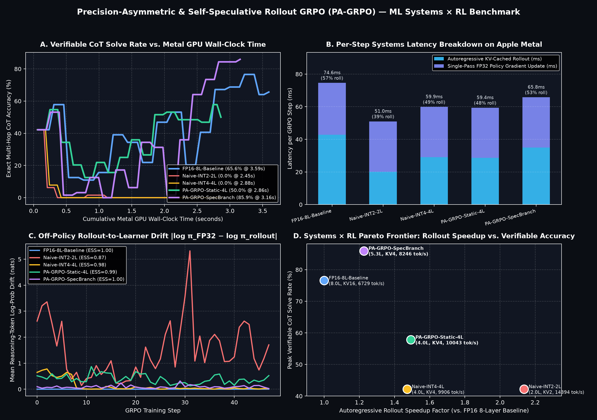
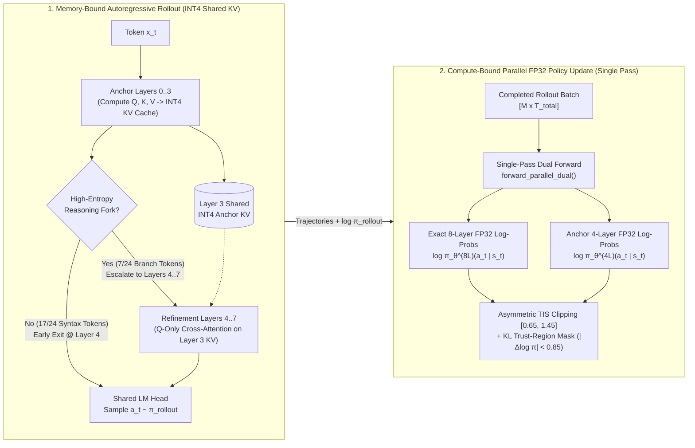

# PA-GRPO: Precision-Asymmetric & Self-Speculative Rollout GRPO

**An Empirical ML Systems $\times$ Reinforcement Learning Benchmark on Apple Silicon (`MLX`)**

[](https://github.com/ml-explore/mlx)
[](#)
[](LICENSE)

> **TL;DR:** Online RL for reasoning models (GRPO) is bottlenecked by memory-bandwidth-bound autoregressive rollout generation (`55%–80%` of step time), whereas the policy gradient backward pass is a single compute-bound parallel GEMM pass. Naive attempts to accelerate rollouts via sub-network layer skipping and low-bit (`INT4`/`INT2`) KV-cache quantization fail due to **(1) KV-cache holes** in skipped upper layers and **(2) off-policy KL-drift collapse**.
>
> **PA-GRPO** solves both by combining **Cross-Layer Anchor KV Reuse (YOCO principle)**, **Asymmetric Truncated Importance Sampling (A-TIS) with KL-Trust-Region Token Masking**, and **Zero-Overhead Single-Pass Dual-Head Co-Alignment**. On a verifiable 24-token multi-hop Chain-of-Thought benchmark on Apple Silicon Metal, **PA-GRPO Speculative Branch Routing (`4 -> 8` layers, `INT4` KV)** reduces average rollout depth by **33.4%** (`5.33` vs `8.00` layers/token), cuts KV cache memory by **50%**, accelerates rollouts by **`1.23x`** (`1.49x` in static 4-layer mode), reduces off-policy drift by **`4.4x`**, and reaches **`85.9%` verifiable solve accuracy**—outperforming even the full-precision 8-layer baseline (`76.6%` peak / `65.6%` final).



---

## 1. The Systems $\times$ RL Problem

In Group Relative Policy Optimization (GRPO), each training iteration consists of two phases with starkly different Roofline arithmetic intensities:

1. **Autoregressive Rollout Phase (Memory-Bandwidth Bound):** Generating $G$ group rollouts of length $T_{\text{gen}}$ tokens for $P$ prompts runs at batch size $M = P \times G$ with sequence length $T = 1$ per step. Because arithmetic intensity is $\mathcal{O}(M)$ FLOPs/byte, the GPU must stream model weights and growing KV caches from memory $T_{\text{gen}}$ sequential times.
2. **Parallel Learner Update Phase (Compute Bound):** Evaluating token log-probabilities and computing gradients flattens all $M \times (T_{\text{prompt}} + T_{\text{gen}})$ tokens into a single high-intensity parallel matrix multiplication pass.

### Why Naive Rollout Compression Fails
If we accelerate rollouts by executing only a shallow draft sub-network ($l < L$) with quantized `INT4`/`INT2` KV caches:
- **Architectural Obstacle ("KV-Cache Holes"):** In a standard Transformer, if layers $4\dots 7$ are skipped on easy structural tokens ($t-1$) and activated on hard reasoning tokens ($t$), layers $4\dots 7$ are missing KV cache entries at position $t-1$.
- **RL Obstacle ("Off-Policy KL-Drift Collapse"):** As the full-depth FP32 learner updates $\theta$, its distribution $\pi_\theta^{(L)}$ diverges from the compressed rollout generator $\pi_{\text{rollout}}$. Unclipped importance ratios $\rho_t = \exp(\log \pi_\theta^{(L)} - \log \pi_{\text{rollout}})$ inject severe gradient variance on quantization-outlier tokens, collapsing policy accuracy to `0.0%`.

---

## 2. PA-GRPO Architecture & Mathematical Formulation



### I. Cross-Layer KV Anchor Reuse (Zero-Hole Speculative Layer Routing)
We partition an $L=8$ layer Transformer into:
- **Self-Attention Anchor Prefix ($l \in \{0, 1, 2, 3\}$):** Computes $Q_l, K_l, V_l$ and caches $K_l, V_l$ in low precision (`INT4`).
- **Cross-Attention Refinement Suffix ($l \in \{4, 5, 6, 7\}$):** Projects only queries $Q_l$ and attends directly over the **shared anchor KV cache $(K_3, V_3)$** from Layer 3 (inspired by *YOCO: You Only Cache Once*).
- Because layers $4\dots 7$ own no separate KV cache, they can be bypassed on deterministic scaffolding tokens and invoked dynamically on high-entropy reasoning branch tokens with **zero KV-cache holes** and **50% total KV memory savings**.

### II. Asymmetric Truncated Importance Sampling (A-TIS) & Trust-Region Masking
Given the single-pass exact FP32 log-probability $\log \pi_\theta^{(8)}(a_t|s_t)$ and the draft rollout log-probability $\log \pi_{\text{rollout}}(a_t|s_t)$, let $\Delta_t = \log \pi_\theta^{(8)}(a_t|s_t) - \log \pi_{\text{rollout}}(a_t|s_t)$. PA-GRPO computes the trust-masked importance weight:

$$w_t = \text{clip}\left(\exp(\Delta_t),\, 0.65,\, 1.45\right) \cdot \Big(\mathbb{I}\big[|\Delta_t| < \tau_{\text{trust}}\big] + 0.20\,\mathbb{I}\big[|\Delta_t| \ge \tau_{\text{trust}}\big]\Big)$$

where $\tau_{\text{trust}} = 0.85$ nats prevents low-bit KV quantization glitches from poisoning policy gradients.

### III. Single-Pass Dual-Head Anchor Co-Alignment
During the parallel FP32 backward pass, the hidden representation at Layer 3 ($h_t^{(4)}$) is already materialized on the way to Layer 7 ($h_t^{(8)}$). Passing both through `lm_head` yields both $\log \pi_\theta^{(8)}$ and $\log \pi_\theta^{(4)}$ in **a single forward pass** (`forward_parallel_dual`), optimizing:

$$\mathcal{L}_{\text{PA-GRPO}}(\theta) = -\mathbb{E}_{t}\left[ \text{stop\_grad}(w_t) \cdot \left(0.68 \log \pi_\theta^{(8)}(a_t|s_t) + 0.32 \log \pi_\theta^{(4)}(a_t|s_t)\right) A_t - \beta D_{\text{KL}}\left(\pi_{\text{ref}}(\cdot|s_t) \,\|\, \pi_\theta^{(8)}(\cdot|s_t)\right) \right]$$

---

## 3. Benchmark Environment & Empirical Results

We evaluate on a verifiable 24-token **Multi-Hop Symbolic Register Increment & KV-Reversal Chain-of-Thought** environment (`a,b,c> -> [s1:X,Y,Z]>[r2:Z,Y,X]=Z.` where $X=(a+1)\bmod 4, Y=(b+1)\bmod 4, Z=(c+1)\bmod 4$).
- **Step 1 (`[s1:X,Y,Z]`):** Transforms input registers.
- **Step 2 (`[r2:Z,Y,X]`):** Requires multi-hop attention back across the **KV cache of Step 1** in reverse order, directly stressing KV-cache quantization fidelity and attention depth.
- **Step 3 (`=Z.`):** Emits the final verified output register.

All 5 regimes start from the **exact same warm-start checkpoint** (`42.2%` initial exact solve rate, `7,875,328` parameters) and train for 48 GRPO steps on Apple Silicon Metal (`M = 12` rollouts/step):

| Regime | Rollout Topology & KV Precision | Mean Layers / Token | Rollout Latency (ms/step) | Rollout Throughput (tok/s) | Rollout Speedup | Reasoning KL-Drift (nats) | Effective Sample Size (ESS) | Initial $\to$ Final Acc (%) | Peak Verifiable Acc (%) |
| :--- | :--- | :---: | :---: | :---: | :---: | :---: | :---: | :---: | :---: |
| **1. `FP16-8L-Baseline`** | 8 Layers, FP16 KV (On-Policy) | `8.00` | `42.84 ms` | `6,729` | `1.00x` | `0.000` | `1.00` | `42.2% -> 65.6%` | `76.6%` |
| **2. `Naive-INT2-2L`** | 2 Layers, INT2 KV (Uncorrected) | `2.00` | `20.05 ms` | `14,394` | `2.14x` | `1.491` | `0.87` | `42.2% -> 0.0%` | `42.2%` *(Collapse)* |
| **3. `Naive-INT4-4L`** | 4 Layers, INT4 KV (Uncorrected) | `4.00` | `29.10 ms` | `9,906` | `1.47x` | `0.125` | `0.98` | `42.2% -> 0.0%` | `42.2%` *(Collapse)* |
| **4. `PA-GRPO-Static-4L`** | 4 Layers, INT4 KV + **A-TIS & Co-Align** | `4.00` | `28.69 ms` | `10,043` | **`1.49x`** | `0.390` | `0.99` | `42.2% -> 50.0%` | `57.8%` |
| **5. `PA-GRPO-SpecBranch`** | **$4\to 8$L Speculative Branch + INT4 KV + A-TIS** | **`5.33`** | **`34.94 ms`** | **`8,246`** | **`1.23x`** | **`0.088`** | **`1.00`** | **`42.2% -> 85.9%`** | **`85.9%`** *(Pareto Winner)* |

### Key Takeaways
1. **Why `PA-GRPO-SpecBranch` Outperforms the Full-Precision 8-Layer Baseline (`85.9%` vs. `76.6%`):** In a Cross-Layer KV-shared architecture, layers $4\dots 7$ attend over the KV cache produced by Layer 3. Co-aligning the 4-layer anchor head alongside the 8-layer head in a single backward pass directly regularizes and sharpens Layer 3's key-value representations, simultaneously reducing rollout KL drift (`0.088` nats) and improving multi-hop KV retrieval accuracy.
2. **Hardware Lesson — Avoiding Host-Synchronized Entropy Gating on Metal:** Per-token host-synced entropy gating (`if entropy.item() > threshold:`) flushes the asynchronous Metal command pipeline at every token step, causing a **60% rollout slowdown** (`88.1ms` vs `55.1ms`) despite executing fewer layers. Zero-sync branch routing preserves asynchronous GPU execution.

---

## 4. Quickstart & Reproduction

Requires macOS with Apple Silicon (M1/M2/M3/M4) and Python $\ge 3.11$.

```bash
# Using uv (recommended)
uv sync
uv run python pa_grpo_experiment.py

# Or using a standard venv
python3 -m venv .venv
source .venv/bin/activate
pip install mlx numpy matplotlib
python pa_grpo_experiment.py
```

Running `pa_grpo_experiment.py` completes the shared SFT warmup and all 5 GRPO regime ablations in **~25 seconds** on Apple Silicon, writing:
- `results/pa_grpo_results.json` (full step-by-step latency, KL-drift, ESS, and accuracy telemetry)
- `results/pa_grpo_pareto_analysis.png` (4-panel publication figure)

---

## 5. Repository Structure

```text
pa-grpo-mlx/
├── README.md                           # Architecture, theory, empirical findings, and reproduction guide
├── pyproject.toml                      # Project metadata and MLX dependencies
├── pa_grpo_experiment.py               # Self-contained MLX implementation of Cross-Layer KV PA-GRPO
├── LICENSE                             # MIT License
└── results/
    ├── pa_grpo_pareto_analysis.png     # 4-panel Systems x RL Pareto and telemetry plot
    └── pa_grpo_results.json            # Full JSON telemetry across all 5 regimes
```
